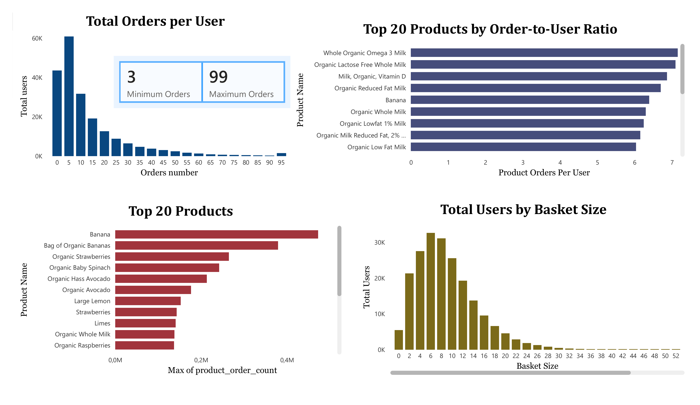
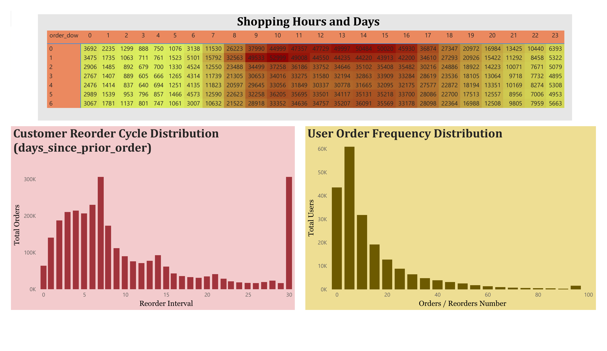
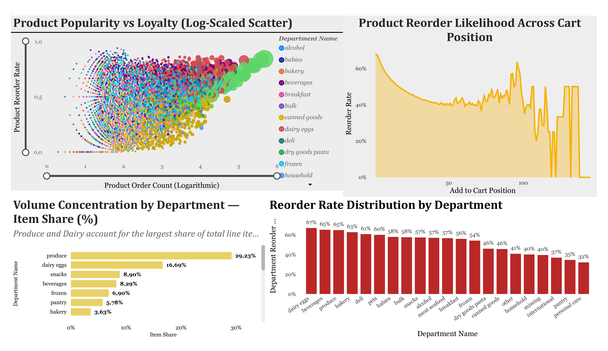

# Predictive Analytics using SQL and Machine Learning: The case of Instacart

## Overview
This repository contains the code developed for my Master's thesis, which focuses on predictive analytics using SQL-based feature engineering and machine learning techniques applied to the Instacart Online Grocery dataset. The project covers the full pipeline: database design and feature engineering in PostgreSQL, interactive dashboards in Power BI, and a reorder-prediction model in Python (XGBoost).

## Thesis Title
*Predictive Analytics using SQL and Machine Learning: The case of Instacart*

## Dataset
The [Instacart Online Grocery Shopping Dataset](https://www.kaggle.com/datasets/psparks/instacart-market-basket-analysis) contains anonymized data on over 3 million grocery orders from more than 200,000 users.

The raw data and the intermediate data files are not included in this repository; the dataset can be downloaded from the link above.

## Pipeline
```
Raw Instacart CSV files
   └─> PostgreSQL: schema, data import, feature engineering        (sql/)
         └─> ml_dataset_final: one row per (user, product) pair
               ├─> Power BI dashboards                             (dashboards/)
               └─> XGBoost reorder-prediction model in Python      (machine-learning/)
```

## Repository Structure
```
├── sql/
│   ├── 01_db_creation.sql                        # Database schema and table creation
│   ├── 02_data_import.sql                        # Data import and loading
│   ├── 03_ml_dataset.sql                         # ML dataset construction
│   ├── 04_feature_engineering_product.sql        # Product-level features
│   ├── 05_feature_engineering_user_product.sql   # User-product interaction features
│   ├── 06_feature_engineering_user.sql           # User-level features
│   ├── 07_user_feature_table.sql                 # User feature table
│   ├── 08_product_feature_table.sql              # Product feature table
│   └── 09_user_product_feature_table.sql         # User-product feature table
│
├── dashboards/
│   ├── dashboard_general.png                     # Orders, top products & basket size
│   ├── dashboard_user.png                        # Shopping hours, reorder cycle & frequency
│   └── dashboard_product.png                     # Product popularity, loyalty & department analysis
│
└── machine-learning/
    ├── Instacart ML.ipynb                        # Main model: sampling, split, tuning, evaluation
    ├── Instacart ML v2 - check_new_feature.ipynb # Experiment: one additional timing feature
    ├── instacart_utils.py                        # Helper functions (per-order F1, basket selection)
    ├── best_params.json                          # Tuned XGBoost hyperparameters
    ├── tuning_log.csv                            # Validation PR-AUC of every tuning run
    ├── test_ranking_metrics.csv                  # Test set: PR-AUC and ROC-AUC
    ├── test_decision_metrics.csv                 # Test set: F1, precision, recall, basket size
    └── feature_importance.csv                    # Feature importance (gain)
```

## Power BI Dashboards

Interactive dashboards built in Power BI to explore the feature-engineered data.

**General Overview**

Total orders per user, top 20 products by order-to-user ratio, most ordered products, and basket size distribution.

**User Behavior**

Shopping activity by hour and day of week, customer reorder cycle distribution, and user order frequency distribution.

**Product Analysis**

Product popularity vs. reorder loyalty, reorder likelihood by cart position, and volume/reorder rate concentration by department.

## Machine Learning Model

**Task:** for every product a user has bought before, predict whether it will be reordered in the user's next order, and turn these predictions into a recommended basket per user.

**Approach** ([main notebook](machine-learning/Instacart%20ML.ipynb))
- **Data:** a deterministic 20% sample of users (26,261 users, ~1.7M user–product rows, ~9.8% positive class)
- **Split by user:** 70% train / 15% validation / 15% test, so no user appears in more than one set
- **Model:** XGBoost, tuned with a staged grid search on validation PR-AUC, with early stopping
- **From probabilities to baskets:** three strategies compared: a global F1 threshold, a threshold maximizing mean F1 per order, and per-user selection by expected F1
- All modelling decisions were made on the validation set; the test set was used only once, for the final evaluation

**Results on the test set (3,940 unseen users)**

| Model | PR-AUC | ROC-AUC |
|---|---|---|
| XGBoost | **0.431** | **0.836** |
| Baseline: user's order rate for the product | 0.216 | 0.767 |

| Basket strategy | Mean F1 per order | Global F1 | Avg. basket size |
|---|---|---|---|
| Baseline: reorder all products from the last order | 0.312 | 0.348 | 10.5 |
| XGBoost, global F1 threshold | 0.379 | **0.446** | 7.4 |
| XGBoost, mean-F1-per-order threshold | 0.383 | 0.445 | 8.7 |
| XGBoost, per-user selection (expected F1) | **0.394** | 0.431 | 9.4 |

The actual average basket is 6.4 reordered products per user.

**Key findings**
- User–product features account for ~81% of the model's total gain: a user's own history with a product is by far the strongest predictor of a reorder.
- Hyperparameter tuning improved validation PR-AUC by only ~0.0015; performance comes mainly from the SQL feature engineering.
- **v2 experiment** ([notebook](machine-learning/Instacart%20ML%20v2%20-%20check_new_feature.ipynb)): adding the days since the last purchase of the product at the time of the target order improved validation PR-AUC by 0.0018, but did not change basket-level F1.

## How to Reproduce
1. Download the dataset from Kaggle.
2. Run the SQL scripts in `sql/` in PostgreSQL to create the database, import the data and build `ml_dataset_final`.
3. Install the Python dependencies:
   ```
   pip install pandas sqlalchemy psycopg2-binary scikit-learn xgboost pyarrow
   ```
4. Run `machine-learning/Instacart ML.ipynb`. Section 2 connects to a local PostgreSQL database named `instacart` (the password is requested at runtime) and caches the sample as Parquet; the later sections read from that cache.

## Tools & Technologies
- **Database:** PostgreSQL 17
- **Query Tool:** pgAdmin 4
- **BI Tool:** Power BI
- **Language:** Python 3.12 (pandas, scikit-learn, XGBoost, Jupyter)
- **Version Control:** Git / GitHub

## Status
🔄 In progress - expected completion: October 2026